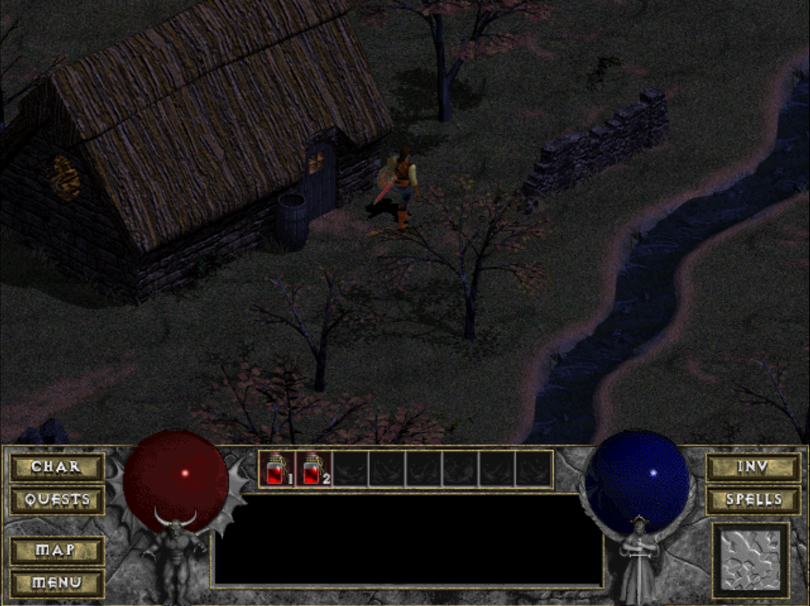

# Diablo Web - Play Diablo 1 in your browser



**[Play the Live Demo](https://johnimril.github.io/diablo_web/)**

- **Play Free Demo** starts the limited shareware version. No purchase or local MPQ is required.
- **Load Your MPQ** starts the full game with your own `DIABDAT.MPQ` from a legal copy of Diablo.
  You can also drop the file onto the start screen.

A React + TypeScript client built with Vite, integrating an existing WebAssembly version of the Diablo engine.
It handles runtime lifecycle, canvas rendering, browser input, game files, and saves.

## Author

Browser-client modernization by **[Nikita Maksimov](https://github.com/JohnImril)**.
[Portfolio](https://nikitamaksimov.dev).

My work includes the React/TypeScript shell, runtime orchestration and worker integration, browser storage and save
management, and the build and static deployment setup. It builds on earlier browser and WebAssembly work; the
original game, reconstructed engine, and initial WebAssembly port are credited in [Origins and Credits](#origins-and-credits).

## Playing and Saving

Choose **Play Free Demo** for limited shareware content, or **Load Your MPQ** for the full game.
Retail game data is not included; use your own `DIABDAT.MPQ` from a legal copy of Diablo.
MPQ compression is optional and available under **Controls, limitations & game files**.

Saves stay in this browser/profile, with no cloud sync. Export through **Manage Saves** before clearing browser
data or changing devices. To import your first save, drop a `.sv` file onto the start screen.
Keep the game in one tab or app window; if **Game already open** appears, close the other instance and choose
**Try Again**. Do not clear browser data to resolve it.

The installable PWA caches app and engine assets; the demo archive is stored after its first download.
Updates wait until gameplay and tracked storage writes finish. Desktop mouse and keyboard work best;
touch controls remain limited.

See the **[player guide](https://johnimril.github.io/diablo_web/help.html)** for controls, save recovery,
offline use, and multiplayer steps. Its source is [public/help.html](./public/help.html).

## Engineering and Architecture

React UI calls a runtime layer that manages the WASM worker, canvas/input, networking, and IndexedDB saves.
Domain code lives in `src/modules/`, orchestration in `src/app/runtime/`, and PWA coordination in
`src/app/updates/`. See [ARCHITECTURE.md](./ARCHITECTURE.md) for boundaries and the feature workflow.

## Getting Started

### Prerequisites

- Node.js 24 LTS (used by the GitHub Actions CI and deployment workflows) and npm.
- A browser with WebAssembly, Web Workers, IndexedDB, and Web Locks support. The app refuses to open save storage
  when Web Locks are unavailable.
- Serve the app over HTTPS, or use localhost for development and preview. Plain HTTP on a remote host or LAN IP
  does not provide the secure context required by Web Locks.
- Shareware data or your own retail MPQ to play locally.

### Installation

```bash
git clone https://github.com/JohnImril/diablo_web.git
cd diablo_web
npm install
```

For **Play Free Demo**, ensure `public/spawn.mpq` is available in your checkout. The demo loader requests this
file from the app's static assets. For the full game, select your own `DIABDAT.MPQ` through **Load Your MPQ**;
placing it in `public/` does not automatically select it.

### Development

Start the Vite development server:

```bash
npm run dev
```

Open [http://localhost:5173/diablo_web/](http://localhost:5173/diablo_web/).
If the port is busy, use the URL printed by Vite.

Run the code checks:

```bash
npm run lint
npm test
```

### Production Build

Build the client and preview the result locally:

```bash
npm run build
npm run preview
```

The build runs TypeScript checking before Vite bundling and writes the output to `dist/`.
Open the preview URL printed in the terminal.

## Deployment

The client runs on static hosting; single-player and the demo need no game backend or `VITE_WS_URL`.
The base path is `/diablo_web/` in [vite.config.ts](./vite.config.ts), matching the GitHub Pages demo.

The [deployment workflow](./.github/workflows/deploy.yml) installs dependencies with `npm ci`, runs linting and unit tests,
builds the client, and publishes `dist/` to GitHub Pages through the `github-pages` environment.
Markdown-only changes are excluded from automatic deployment.
For another host or path, follow the URL and PWA checklist in the deployment guide.

See the [deployment guide](./docs/DEPLOYMENT.md) for build identity, storage resets, and rollback behavior.

For a simpler deployment-oriented variant, see
[diablo_web_simple](https://github.com/JohnImril/diablo_web_simple).

## Multiplayer

[hellgate-ws](https://github.com/JohnImril/hellgate-ws) provides the experimental WebSocket multiplayer backend
for up to four players. Set `VITE_WS_URL` to your server's `wss://…/ws` endpoint at build time, then choose
**Multi Player → WebSocket (Server)** in the game. **WebRTC (Direct)** is a separate transport.
Follow the [client connection guide](https://github.com/JohnImril/hellgate-ws/blob/main/docs/client.md)
for local setup, a two-player check, and troubleshooting.

## Status and Next Steps

The browser client already includes:

- Loading progress, bounded retries for interrupted downloads, runtime error recovery, and diagnostic reports.
- Save import/export, metadata caching, tracked writes with retry, and in-memory save downloads when reload is blocked.
- Exclusive save-storage ownership across tabs, an IndexedDB v5 migration barrier, and guarded save-data resets.
- Installable PWA support, cached app assets, and updates coordinated with game activity and pending storage writes.
- React/TypeScript runtime separation, import-boundary lint checks, unit tests, and CI/deployment checks.

Remaining limitations and areas for improvement:

- Mobile and touch controls still need refinement.
- Online multiplayer is experimental; codec and server tests do not establish full WASM gameplay compatibility.
- Licensing for the client, inherited code, and bundled WASM artifacts still needs clarification.

## Origins and Credits

- **Diablo:** the original game by Blizzard North; game data, artwork, audio, and names belong to their respective owners.
- **[devilution](https://github.com/diasurgical/devilution):** reconstruction of the original engine by GalaXyHaXz
  and the devilution community.
- **[DiabloWeb](https://github.com/d07RiV/diabloweb):** d07RiV's earlier browser client.
  Its [engine fork](https://github.com/d07RiV/devilution) contains the earlier WebAssembly build work.
- **[diabloweb-beta](https://github.com/JohnImril/diabloweb-beta):** the intermediate modernization fork
  preceding this Vite/TypeScript client.

Nikita Maksimov's contribution is the modernization and integration of the browser client described above.
The original Diablo engine and earlier WebAssembly port are upstream work.

## License and Game Data Rights

This repository does not currently include a project license file. Licensing for the client, inherited code, and
bundled WebAssembly artifacts still needs clarification; no blanket license is asserted here.
Consult the upstream projects' notices, including
[devilution's LICENSE.md](https://github.com/diasurgical/devilution/blob/master/LICENSE.md).

This project does not grant rights to commercial game data. Supply only MPQ files you are legally permitted to use.
